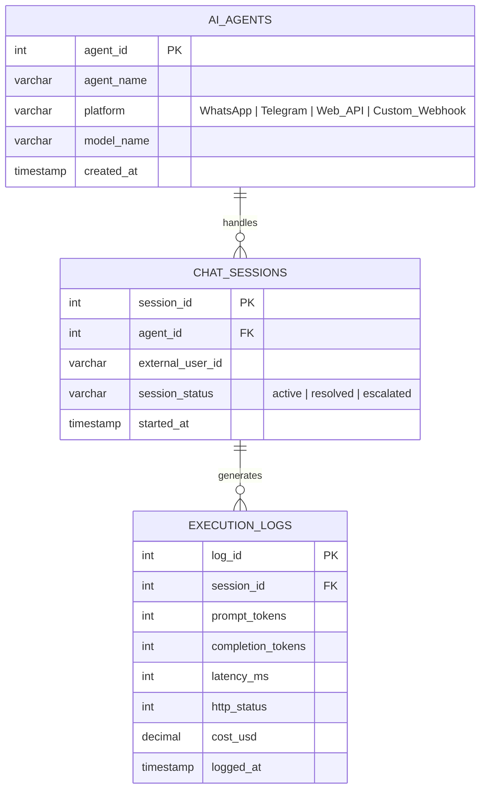

# 🗄️ AI Telemetry, Token Cost & Webhook Logger (SQL + Python)


A lightweight, **3rd Normal Form (3NF)** relational database engine designed to track LLM token consumption, API costs, conversational session states, and webhook execution latency across multi-agent AI workflows.

---

## 🏗️ Entity-Relationship (ER) Schema Diagram



---

## ⚡ Key Database & Engineering Features

* **3rd Normal Form (3NF) Schema Design:** Eliminates data redundancy by separating static agent metadata (`ai_agents`), stateful user conversations (`chat_sessions`), and high-frequency webhook telemetry (`execution_logs`).
* **Strict Data Integrity & Constraints:** Enforces foreign key cascades (`ON DELETE CASCADE`) and domain-level `CHECK` constraints on token counts, latency values, and platform types.
* **Pre-Computed Analytical SQL Views:** Includes `v_agent_performance`, combining multi-table `JOIN` operations, conditional aggregation (`CASE WHEN`), and `GROUP BY` rollups to calculate real-time API success rates and token expenditure.
* **Zero-Dependency Local Execution:** Uses Python's built-in `sqlite3` with context-managed ACID transactions (`with sqlite3.connect(...)`) for instant reproducibility.

---

## 🚀 Quick Start

### 1. Clone the Repository
```bash
git clone [https://github.com/Anandha-Krishnan-Ai-dev/ai-webhook-sql-logger.git](https://github.com/Anandha-Krishnan-Ai-dev/ai-webhook-sql-logger.git)
cd ai-webhook-sql-logger
```

### 2. Run the Telemetry Engine
```bash
python tracker.py
```

---

## 📊 Sample Output

```text
📊 === AI AGENT PERFORMANCE & COST REPORT (SQL VIEW) ===
• SQL Query Assistant (Web_API | claude-3-5-sonnet)
  Requests: 2 | Tokens: 3250 | Avg Latency: 1285.0ms | Success: 100.0% | Cost: $0.0226

• AutoFlow Lead Qualifier (WhatsApp | gpt-4o-mini)
  Requests: 3 | Tokens: 1505 | Avg Latency: 436.67ms | Success: 100.0% | Cost: $0.0005

• Order Status Webhook Bot (Custom_Webhook | gemini-1.5-flash)
  Requests: 2 | Tokens: 385 | Avg Latency: 1695.0ms | Success: 50.0% | Cost: $0.0001

⚠️ === HIGH-LATENCY OR FAILED WEBHOOK CALLS (>1000ms or HTTP != 200) ===
• [504] Order Status Webhook Bot -> User: webhook_order_882 (3100ms)
• [200] SQL Query Assistant -> User: user_dev_101 (1450ms)
• [200] SQL Query Assistant -> User: user_dev_101 (1120ms)
```

---

## 📁 Repository Structure

```text
├── schema.sql       # DDL script: Tables, Foreign Keys, Constraints & Analytical Views
├── tracker.py       # Python database manager & SQL analytics runner
└── README.md        # Architecture documentation & ER Diagram
```
